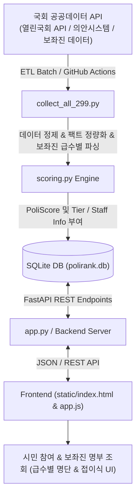

# PoliRank (폴리랭크) 시스템 아키텍처 및 상세 명세서 (SYSTEM SPECIFICATION)

> **문서 버전:** v1.2.0  
> **최종 수정일:** 2026-11-12  
> **기술 스택:** FastAPI | SQLite3 | Python 3.10+ | TailwindCSS | Chart.js | GitHub Actions  

---

## 1. 아키텍처 개요 (System Architecture)

PoliRank는 국회 공공데이터 API(열린국회 API `nwvrqwxyaytdsfvhu`, 의안정보시스템 등)를 수집·가공하여 100% 팩트 기반의 정량 스탯 및 국회의원 보좌진 명부를 산출하고, 대국민 웹 랭킹 및 시민 참여 서비스를 제공하는 데이터 플랫폼입니다.



---

## 2. PoliScore v1.1 스코어링 알고리즘 명세

각 의원의 **종합 PoliScore (100점 만점)**는 6개 정량 지표의 가중합으로 산출됩니다:

$$\text{PoliScore} = (0.25 \times S_{\text{입법}}) + (0.25 \times S_{\text{가결}}) + (0.20 \times S_{\text{출석}}) + (0.15 \times S_{\text{표결}}) + (0.10 \times S_{\text{발언}}) + (0.05 \times S_{\text{세미나}})$$

### 📊 6대 지표 산출 세부 공식

1. **입법 실적 ($S_{\text{입법}}$, 가중치 25%)**
   - 대표발의 건당 **25점**, 공동발의 건당 **6점** 산정 (상한선 100점)
2. **법안 가결 성과 ($S_{\text{가결}}$, 가중치 25%)**
   - 본회의 통과/가결 건당 **55점**, 상임위 소위 통과 건당 **25점** 산정 (상한선 100점)
3. **의정 출석 성실도 ($S_{\text{출석}}$, 가중치 20%)**
   - 본회의 및 상임위 출석률 반영, 무단 결석 및 징계 건 발생 시 감점 적용
4. **전자 안건 표결 참여율 ($S_{\text{표결}}$, 가중치 15%)**
   - 국회 본회의 전자투표 안건 표결 참여율 (%) 1:1 환산
5. **상임위 속기록 발언력 ($S_{\text{발언}}$, 가중치 10%)**
   - 회의록 속기록상 정책 질의 및 발언 빈도 정량화 (100점 만점 스케일링)
6. **정책 세미나/공청회 ($S_{\text{세미나}}$, 가중치 5%)**
   - 주최/주관 세미나 및 대정부 질문 횟수 반영

### 🏅 등급 (Tier Badge) 매핑
- **S+ (Legendary)**: 90점 이상 (상위 3% 최우수 의정)
- **S (Outstanding)**: 80점 ~ 89점
- **A (Excellent)**: 70점 ~ 79점
- **B (Good)**: 60점 ~ 69점
- **C (Needs Improvement)**: 60점 미만

---

## 3. 데이터베이스 스키마 및 보좌진 명부 (Database & Staff Schema)

### `members` 테이블 주요 컬럼
- `id` (TEXT, PK): 의원 고유 식별자 (예: `mem_22_8BF5855P`)
- `mona_cd` (TEXT): 열린국회 고유 코드
- `name` (TEXT): 의원 성명
- `party` (TEXT): 소속 정당
- `district` (TEXT): 지역구 / 비례대표
- `photo_url` / `official_photo_url` (TEXT): 국회 공식 고화질 프로필 사진 URL
- `total_score` (REAL): 종합 PoliScore 점수 (100점 만점)
- `tier` (TEXT): 의원 등급 (`S+`, `S`, `A`, `B`, `C`)
- `cheer_count` (INTEGER): 실시간 유저 1클릭 응원 하트 수
- `media_mentions` (INTEGER): 뉴스 언론 언급 횟수
- `quote` (TEXT): 시그니처 대표 어록
- `keywords_json` (TEXT): 시그니처 해시태그 (JSON 문자열)
- `weekly_stats_json` (TEXT): 14대 공공 팩트 지표 세부 데이터 (JSON 문자열)
- **`staff_total_count` (INTEGER)**: 국회의원실 전체 보좌진 수
- **`staff_advisors_4th_json` (TEXT)**: 4급 보좌관 이름 리스트 (JSON Array, 예: `["김홍", "서용선"]`)
- **`staff_secretaries_5th_json` (TEXT)**: 5급 비서관 이름 리스트 (JSON Array, 예: `["김동준", "이경열"]`)
- **`staff_assistants_6to9th_json` (TEXT)**: 6~9급 비서 및 인턴 이름 리스트 (JSON Array, 예: `["김한올", "김은민", ...]`)

### 📋 API `staff_info` 응답 객체 구조
```json
"staff_info": {
  "total_count": 10,
  "advisors_4th": ["김홍", "서용선"],
  "secretaries_5th": ["김동준", "이경열"],
  "assistants_6to9th": ["김한올", "김은민", "이현", "김희경", "채윤아", "한고은"]
}
```

---

## 4. UI/UX 구성 (국회의원 상세 모달 & 보좌진 명부)

1. **의원 메인 카드**: `보좌진 N명` 태그를 소형 배지로 직관적 표기.
2. **국회의원 상세 모달**:
   - `보좌진 N명` 요약 배지 노출.
   - `보좌진 명단 보기` 토글 버튼 제공 (클릭 시 180도 화살표 회전 및 접이식 패널 토글).
   - **급수별 명단 분류**: 4급 보좌관, 5급 비서관, 6~9급/인턴 비서관·비서를 직관적인 뱃지 컬러(보라/파랑/회색)와 성명 태그로 시각화.

---

## 5. 자동화 및 배포 파이프라인

- **자동 업데이트 파이프라인**: 매주 월요일 00:00 KST에 GitHub Actions(`.github/workflows/weekly_update.yml`)가 자동으로 공공데이터를 갱신하고 스코어를 재계산합니다.
- **컴플라이언스 준수**: 공직선거법 및 정치자금법을 준수하여 사설 결제망을 일체 차단하고 선관위 공식 사이트(`give.go.kr`)로 아웃링크 처리합니다.
